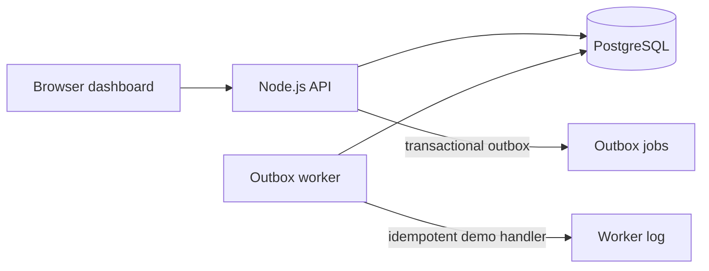

# Operations Under Pressure

A compact full-stack operations tracker for teams handling incidents, customer issues, payments, compliance work, and routine tasks. The browser dashboard supports server-side search and filtering, cursor pagination, claims, workflow actions, and activity history. The API enforces team roles, records changes transactionally, and protects retries and concurrent edits.

## Run it

Prerequisites: Docker Desktop or Docker Engine with the Compose plugin.

```sh
docker compose up --build
```

Optionally set `HOST_PORT` in your shell or `.env` to change the published port. Open [http://localhost:3000](http://localhost:3000) by default. The database initializes from `db/schema.sql`; the app seeds demo users and 2,000 sample work items on startup. Stop with `Ctrl+C`. Remove the database volume to reset all demo data: `docker compose down -v`.

Demo password for all accounts: `newtonite123`.

| Team | Role | Email |
| --- | --- | --- |
| North Operations | Lead | `alex@example.com` |
| North Operations | Member | `sam@example.com` |
| North Operations | Viewer | `riley@example.com` |
| North Operations | Admin | `jordan@example.com` |
| South Operations | Lead | `taylor@example.com` |
| South Operations | Member | `casey@example.com` |
| Finance Operations | Lead | `morgan@example.com` |
| Finance Operations | Member | `jamie@example.com` |
| Compliance Operations | Lead | `drew@example.com` |
| Compliance Operations | Member | `sky@example.com` |

The demo accounts use seeded tokens and a fixed salt to keep local setup straightforward. Replace this authentication setup, password handling, and demo secrets before any public deployment. There is no public sign-up.

## Tests

With the app and database running:

```sh
docker compose exec app npm test
```

The API tests cover idempotent create retries, simultaneous claim races, stale versions, workflow constraints and approval permissions, team-scoped access, Viewer restrictions, and append-only activity. They use the seeded PostgreSQL database. The worker is started as a separate Compose service and consumes outbox records.

## Workflow and API

`open → in_progress → awaiting_approval → resolved → closed`. Members can move work into the approval queue, but only a team Lead can resolve it. Invalid jumps are rejected by the API. The client sends the item version for edits and transitions; stale changes return `409 Conflict`.

The API exposes `POST /api/login`, `GET /api/me`, `GET /api/items`, `POST /api/items`, `GET /api/items/:id`, `PATCH /api/items/:id`, `POST /api/items/:id/claim`, `POST /api/items/:id/transition`, `POST /api/items/:id/comments`, and `GET /api/items/:id/activity`. Mutating requests use bearer tokens; item access is scoped to a team membership. Item creation requires an `Idempotency-Key` header. List filters include team, status, priority, type, view, and search; results are ordered by creation time and use a stable cursor.



## Known limitations

- Demo authentication uses seeded credentials, a fixed salt, and long-lived static bearer tokens. Use a production identity provider and proper password hashing, token expiry, rotation, CSRF protections, and secret management before deployment.
- The outbox worker demonstrates atomic enqueue, row locking, bounded retries, and an idempotent handler by logging notifications. It does not deliver email or integrate with an external queue.
- The dashboard keeps the currently selected page in memory and provides a next-page cursor; it does not yet provide previous-page navigation or editable assignment controls.
- Tests need a running PostgreSQL instance initialized with the schema and seed data.
- This focused implementation has no file attachments, SSO, WebSockets, mobile UI, or production deployment configuration.

## Next week

Replace demo auth, add a dedicated assignment and edit form, expand API validation, add cursor navigation in both directions, collect worker metrics, and run a browser-level accessibility review.
